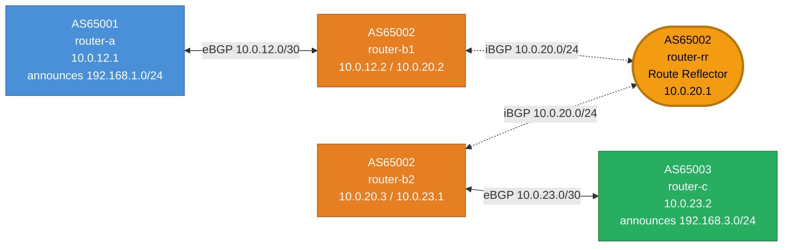

# Mermaid Diagram Style Guide

Visual conventions for topology diagrams in bgp-labs. Consistent color and line style let readers immediately distinguish AS boundaries and session types without reading labels.

## Quick Rules

| What | How |
|------|-----|
| Each AS gets one color | Nodes in the same AS share a `classDef` fill color |
| eBGP session | Solid line `<-->` |
| iBGP session | Dashed line `<-.->` |
| Route Reflector | Stadium shape `([RR])` + `rr` class (yellow, bold border) |
| Host/endpoint (not a router) | Rounded rectangle `(host)` + `host` class (gray) |

## AS Color Palette

```
classDef as1 fill:#4a90d9,color:#fff,stroke:#2c6fad
classDef as2 fill:#e67e22,color:#fff,stroke:#a85a17
classDef as3 fill:#27ae60,color:#fff,stroke:#1a7a40
classDef as4 fill:#8e44ad,color:#fff,stroke:#6c3483
classDef as5 fill:#c0392b,color:#fff,stroke:#922b21
```

Assign `as1` through `as5` in AS-number order within the diagram. `as1` always goes to the lowest-numbered AS — don't skip colors.

Special node classes:

```
classDef rr    fill:#f39c12,color:#000,stroke:#b7770d,stroke-width:3px
classDef host  fill:#95a5a6,color:#fff,stroke:#707b7c
```

## Link Conventions

```
RouterA <-->|"eBGP 10.0.12.0/30"| RouterB       ← solid = eBGP
RouterB1 <-.->|"iBGP 10.0.20.0/24"| RouterRR    ← dashed = iBGP
```

Link label format: `"<session-type> <subnet>"`. For iBGP full-mesh over a shared segment, one label on each link is fine — don't label every pair identically.

## Node Label Format

```
A["AS65001\nrouter-a\n10.0.12.1"]
```

Include: AS number, container name, key interface IPs. Add announced prefixes when relevant to the lab objective. Use `\n` (not `<br>`) — it renders cleanly and is readable in source.

For a Route Reflector node, add the role:

```
RR(["AS65002\nrouter-rr\nRoute Reflector"])
```

## Complete Template



## Subgraphs (optional)

Use subgraphs only when the AS boundary is the point of the diagram — e.g. a transit lab showing traffic entering and leaving an AS. For most topology diagrams, color is enough.

```
subgraph AS65002["AS 65002 — Transit"]
    B1
    RR
    B2
end
```

Subgraphs add visual grouping but can make the layout harder to read in dense diagrams. Prefer them only when the AS boundary is being taught (e.g. transit, route leaking).

## What Each Visual Cue Teaches

| Cue | Learning signal |
|-----|----------------|
| Same color = same AS | iBGP sessions stay within one color group |
| Dashed line | iBGP doesn't carry routes to the next AS on its own |
| Solid line | eBGP crosses an AS boundary |
| Yellow RR node | The Route Reflector is the hub; all iBGP clients connect to it |
| Gray host node | Not a router — doesn't run BGP, just a reachability target |
